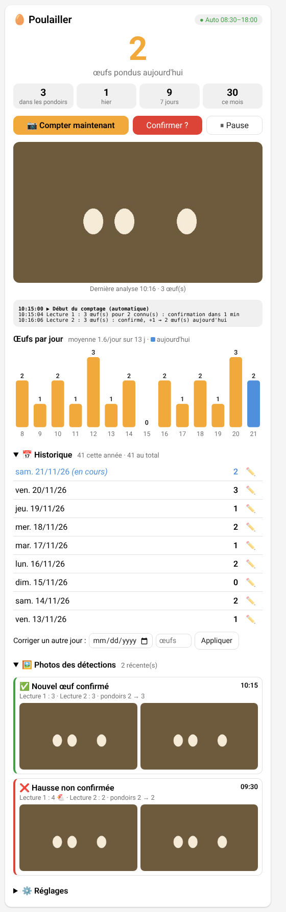

# 🥚 Comptage Œufs Poulailler

[🇬🇧 English](README.md) · 🇫🇷 Français

Intégration Home Assistant qui **compte les œufs pondus chaque jour** grâce à une caméra qui filme les pondoirs et à l'IA de Home Assistant (`ai_task` : Google Gemini, OpenAI, Ollama…).

🌍 Disponible en **français, English, Deutsch, Español, Italiano, Nederlands et Português** : écrans de configuration, entités, journal, notifications, consigne de l'IA et carte suivent la langue de Home Assistant.



## Fonctionnalités

- 📷 **Comptage automatique** toutes les N minutes entre une heure de début et une heure de fin réglables, plus un dernier comptage pile à l'heure de fin (refait 5 min plus tard s'il échoue).
- ✅ **Double lecture** : un nouvel œuf n'est validé que si une 2ᵉ lecture, faite quelques minutes plus tard, le confirme.
- 🧺 **Ramassage géré** : l'intégration suit le nombre d'œufs *présents dans les pondoirs* et compte chaque hausse. Ramasser les œufs à midi n'empêche plus de compter ceux pondus l'après-midi, et les œufs laissés la nuit ne sont pas recomptés le lendemain.
- 🐔 **Poule sur le nid** : l'IA indique si une poule cache un nid. Une baisse n'est alors pas prise pour un ramassage.
- 💸 **Économie d'appels IA** : si l'image n'a presque pas changé depuis la dernière analyse, l'IA n'est pas rappelée (au plus 1 h sans appel).
- 🔁 **Nouveaux essais automatiques** (jusqu'à 4 essais sur environ 3 min 30) si la caméra ou l'IA ne répond pas, avec la raison affichée dans le journal (ex. « service d'IA surchargé »).
- 🖼️ **Photos des détections** : à chaque œuf confirmé (et à chaque hausse non confirmée ou ramassage), les deux photos analysées sont gardées, avec les valeurs lues, pour comprendre une erreur de comptage. Elles sont visibles dans la carte et dans **Médias › Médias locaux › comptage_oeufs_poulailler**.
- 📅 **Historique illimité**, corrigeable jour par jour (y compris aujourd'hui).
- 🔔 **Notification** à chaque nouvel œuf (n'importe quelle entité `notify` ou action de notification) et événement `comptage_oeufs_poulailler_nouvel_oeuf` pour vos automatisations.
- 🃏 **Carte Lovelace incluse**, sans dépendance (pas besoin d'apexcharts-card).

## Prérequis

- Home Assistant 2025.8 ou plus récent.
- Une intégration d'IA qui fournit une entité **AI Task** capable d'analyser une image (ex. *Google Generative AI*, *OpenAI*). Avec Gemini, un modèle « Lite » comme `gemini-flash-lite-latest` est rapide, économique et moins souvent saturé.
- Une caméra qui voit les pondoirs.
- Un dossier média (par défaut `/media`, présent sur Home Assistant OS) pour conserver les photos.

## Installation

### Avec HACS
1. HACS › menu ⋮ › **Dépôts personnalisés** › ajoutez `https://github.com/JVmaisGpeur/ha-comptage-oeufs-poulailler`, catégorie **Intégration**.
2. Installez **Comptage Œufs Poulailler**, puis redémarrez Home Assistant.

### Manuellement
Copiez `custom_components/comptage_oeufs_poulailler` dans votre dossier `config/custom_components/`, puis redémarrez.

## Configuration

**Paramètres › Appareils et services › Ajouter une intégration › Comptage Œufs Poulailler**, puis choisissez :

| Champ | Rôle |
|---|---|
| Nom du poulailler | Nom de l'appareil et préfixe des entités (`sensor.poulailler_…`) |
| Caméra des pondoirs | Caméra analysée |
| IA à utiliser | Entité `ai_task` (vide = IA par défaut) |
| Nombre de pondoirs | Utilisé dans la consigne donnée à l'IA |
| Notification | Entité `notify` prévenue à chaque nouvel œuf |
| Importer l'historique | Un `input_text` au format `jj/mm/aa:n;…` à reprendre |

Le bouton **Configurer** permet ensuite de changer la consigne de l'IA (`{pondoirs}` est remplacé par le nombre de pondoirs), le seuil de changement d'image, la durée de conservation des photos (30 jours par défaut) ou une action de notification (ex. `notify.mobile_app_telephone`).

## Carte

Elle est chargée automatiquement. Ajoutez-la à un tableau de bord :

```yaml
type: custom:comptage-oeufs-poulailler-card
```

Options (toutes facultatives) :

| Option | Défaut | Description |
|---|---|---|
| `entry_id` | premier poulailler | Pour choisir un poulailler s'il y en a plusieurs |
| `title` | nom du poulailler | Titre affiché |
| `language` | langue de l'utilisateur | Forcer une langue : `en`, `fr`, `de`, `es`, `it`, `nl`, `pt` |
| `days` | `14` | Nombre de jours dans le graphique |
| `history_days` | `60` | Nombre de jours dans l'historique |
| `events` | `12` | Nombre de détections photo affichées |
| `show_live_camera` | `false` | Flux caméra au lieu de la dernière photo analysée (réveille une caméra sur batterie) |
| `show_camera`, `show_journal`, `show_chart`, `show_history`, `show_photos`, `show_settings` | `true` | Afficher / masquer chaque partie |

## Entités créées

Les identifiants suivent la langue de Home Assistant au moment de l'ajout. Exemple en français avec un poulailler nommé « Poulailler » :

| Entité | Description |
|---|---|
| `sensor.<nom>_oeufs_aujourd_hui` | Œufs pondus aujourd'hui (statistiques long terme) |
| `sensor.<nom>_oeufs_hier`, `_oeufs_sur_7_jours`, `_oeufs_ce_mois`, `_oeufs_cette_annee`, `_oeufs_au_total` | Totaux |
| `sensor.<nom>_oeufs_dans_les_pondoirs` | Œufs actuellement vus dans les pondoirs |
| `sensor.<nom>_etat_du_comptage` | Dernière étape (journal complet en attribut) |
| `image.<nom>_dernier_oeuf_detecte` | Photo du dernier œuf confirmé |
| `button.<nom>_compter_maintenant`, `button.<nom>_oeufs_ramasses` | Actions |
| `switch.<nom>_comptage_automatique` | Pause / reprise |
| `time.<nom>_heure_de_debut`, `time.<nom>_heure_de_fin` | Plage de comptage |
| `number.<nom>_intervalle_de_comptage`, `number.<nom>_delai_de_confirmation` | Réglages (minutes) |

## Actions (services)

| Action | Données |
|---|---|
| `comptage_oeufs_poulailler.compter_maintenant` | – |
| `comptage_oeufs_poulailler.corriger` | `date`, `nombre` |
| `comptage_oeufs_poulailler.oeufs_ramasses` | `restants` (0 par défaut) |
| `comptage_oeufs_poulailler.importer_historique` | `entity_id` d'un `input_text` |

Toutes acceptent `config_entry_id` pour viser un poulailler précis.

## Astuces

- **Le comptage rate des œufs ?** Ouvrez « Photos des détections » : les deux photos et les valeurs lues montrent si c'est l'IA qui se trompe (affinez la consigne) ou la photo (cadrage, lumière).
- **L'IA est appelée trop souvent ?** Montez le seuil de changement d'image (ex. 0,3 %). **Un œuf est raté ?** Baissez-le, ou mettez 0 pour toujours appeler l'IA.
- **« Service d'IA surchargé » dans le journal ?** Ça vient du fournisseur d'IA : essayez un modèle plus léger (Gemini « Lite »).
- **Caméra sur batterie** : réduisez la plage horaire et augmentez l'intervalle.

## Traductions

Pour ajouter ou corriger une langue : `translations/<langue>.json` (configuration, entités, actions, erreurs), `i18n.py` (journal, notifications, consigne de l'IA) et l'objet `I18N` de la carte. Les contributions sont les bienvenues !

## Licence

MIT © JVmaisGpeur
