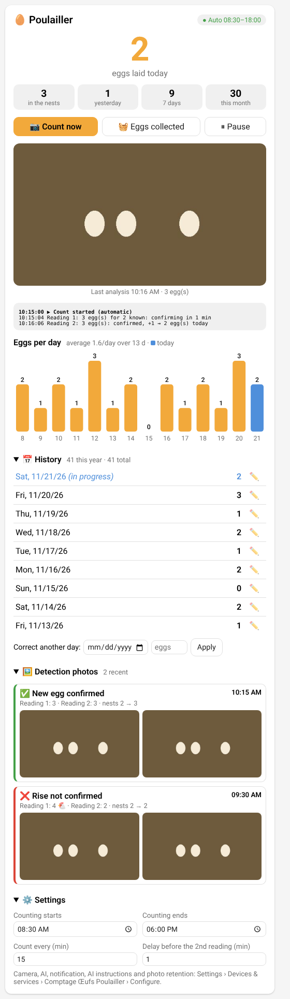

# 🥚 Comptage Œufs Poulailler – Chicken Coop Egg Counter

🇬🇧 English · [🇫🇷 Français](README.fr.md)

Home Assistant integration that **counts the eggs laid every day** using a camera pointed at the nesting boxes and Home Assistant's AI (`ai_task`: Google Gemini, OpenAI, Ollama…).

🌍 Available in **English, Français, Deutsch, Español, Italiano, Nederlands and Português**: setup screens, entities, journal, notifications, AI instructions and card all follow your Home Assistant language.



## Features

- 📷 **Automatic counting** every N minutes between an adjustable start and end time, plus a last count right at the end time (retried 5 min later if it fails).
- ✅ **Double reading**: a new egg is only validated if a second reading, taken a few minutes later, confirms it.
- 🧺 **Egg collection handled**: the integration tracks the number of eggs *currently in the nests* and counts every increase. Collecting the eggs at noon no longer hides the ones laid in the afternoon, and eggs left overnight are not counted again the next day.
- 🐔 **Hen on the nest**: the AI says whether a hen is hiding a nest, so a drop is not mistaken for a collection.
- 💸 **Fewer AI calls**: if the image has barely changed since the last analysis, the AI is not called again (at most 1 h without a call).
- 🔁 **Automatic retries** (up to 4 attempts over ~3.5 min) when the camera or the AI does not answer, with the reason shown in the journal (e.g. “AI service overloaded”).
- 🖼️ **Detection photos**: for every confirmed egg (and every unconfirmed rise or collection) both analysed photos are kept with the values read, to understand a counting mistake. They are shown in the card and in **Media › Local media › comptage_oeufs_poulailler**.
- 📅 **Unlimited history**, editable day by day (today included).
- 🔔 **Notification** on each new egg (any `notify` entity or notify action) and a `comptage_oeufs_poulailler_nouvel_oeuf` event for your automations.
- 🃏 **Lovelace card included**, with no dependency.

## Requirements

- Home Assistant 2025.8 or newer.
- An AI integration providing an **AI Task** entity able to analyse images (e.g. *Google Generative AI*, *OpenAI*). With Gemini, a “Lite” model such as `gemini-flash-lite-latest` is fast, cheap and less often overloaded.
- A camera that sees the nesting boxes.
- A media folder (`/media` by default, present on Home Assistant OS) to keep the photos.

## Installation

### With HACS / the Marketplace
1. Add the custom repository `https://github.com/JVmaisGpeur/ha-comptage-oeufs-poulailler`, category **Integration**.
2. Install **Comptage Œufs Poulailler**, then restart Home Assistant.

### Manually
Copy `custom_components/comptage_oeufs_poulailler` into your `config/custom_components/` folder, then restart.

## Configuration

**Settings › Devices & services › Add integration › Comptage Œufs Poulailler**, then choose:

| Field | Purpose |
|---|---|
| Coop name | Device name and entity prefix |
| Nesting box camera | Camera to analyse |
| AI to use | `ai_task` entity (empty = default AI task) |
| Number of nesting boxes | Used in the instructions given to the AI |
| Notification | `notify` entity alerted on each new egg |
| Import history | Optional `input_text` in the `dd/mm/yy:n;…` format |

The **Configure** button then lets you change the AI instructions (`{pondoirs}` is replaced by the number of nesting boxes; keep the default text to follow Home Assistant's language), the image change threshold, the photo retention (30 days by default) or a notify action (e.g. `notify.mobile_app_phone`).

## Card

It is loaded automatically. Add it to a dashboard:

```yaml
type: custom:comptage-oeufs-poulailler-card
```

Options (all optional):

| Option | Default | Description |
|---|---|---|
| `entry_id` | first coop | Choose a coop if you have several |
| `title` | coop name | Displayed title |
| `language` | user's language | Force a language: `en`, `fr`, `de`, `es`, `it`, `nl`, `pt` |
| `days` | `14` | Number of days in the chart |
| `history_days` | `60` | Number of days in the history |
| `events` | `12` | Number of photo detections shown |
| `show_live_camera` | `false` | Live camera instead of the last analysed photo (wakes up a battery camera) |
| `show_camera`, `show_journal`, `show_chart`, `show_history`, `show_photos`, `show_settings` | `true` | Show / hide each part |

## Entities

Entity IDs follow your language when the integration is added. With an English Home Assistant and a coop named “Coop”:

| Entity | Description |
|---|---|
| `sensor.coop_eggs_today` | Eggs laid today (long-term statistics) |
| `sensor.coop_eggs_yesterday`, `_eggs_last_7_days`, `_eggs_this_month`, `_eggs_this_year`, `_eggs_total` | Totals |
| `sensor.coop_eggs_in_nesting_boxes` | Eggs currently seen in the nests |
| `sensor.coop_counting_status` | Last step (full journal as an attribute) |
| `image.coop_last_detected_egg` | Photo of the last confirmed egg |
| `button.coop_count_now`, `button.coop_eggs_collected` | Actions |
| `switch.coop_automatic_counting` | Pause / resume |
| `time.coop_start_time`, `time.coop_end_time` | Counting window |
| `number.coop_counting_interval`, `number.coop_confirmation_delay` | Settings (minutes) |

## Actions

| Action | Data |
|---|---|
| `comptage_oeufs_poulailler.compter_maintenant` | – (count now) |
| `comptage_oeufs_poulailler.corriger` | `date`, `nombre` (correct a day) |
| `comptage_oeufs_poulailler.oeufs_ramasses` | `restants`, 0 by default (eggs collected) |
| `comptage_oeufs_poulailler.importer_historique` | `entity_id` of an `input_text` (import history) |

All accept `config_entry_id` to target one coop. Action names are kept in French for compatibility; their descriptions are translated in the UI.

## Tips

- **Eggs are missed?** Open “Detection photos”: both photos and the values read show whether the AI is wrong (refine the instructions) or the picture (framing, light).
- **The AI is called too often?** Raise the image change threshold (e.g. 0.3 %). **An egg is missed?** Lower it, or set 0 to always call the AI.
- **“AI service overloaded” in the journal?** That comes from the AI provider. Try a lighter model (Gemini “Lite”).
- **Battery camera**: shorten the time window and increase the interval.

## Translations

Add or fix a language:
- `custom_components/comptage_oeufs_poulailler/translations/<lang>.json` – setup, entities, actions, errors;
- `custom_components/comptage_oeufs_poulailler/i18n.py` – journal, notifications, AI instructions;
- `custom_components/comptage_oeufs_poulailler/frontend/comptage-oeufs-poulailler-card.js` – the card (`I18N`).

Pull requests welcome!

## License

MIT © JVmaisGpeur
